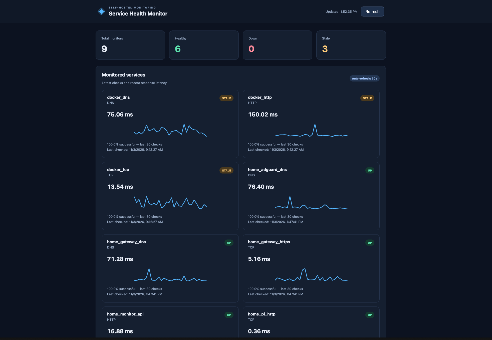
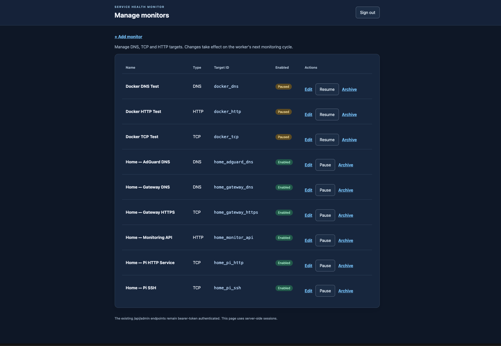
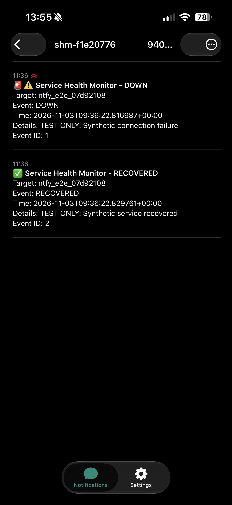
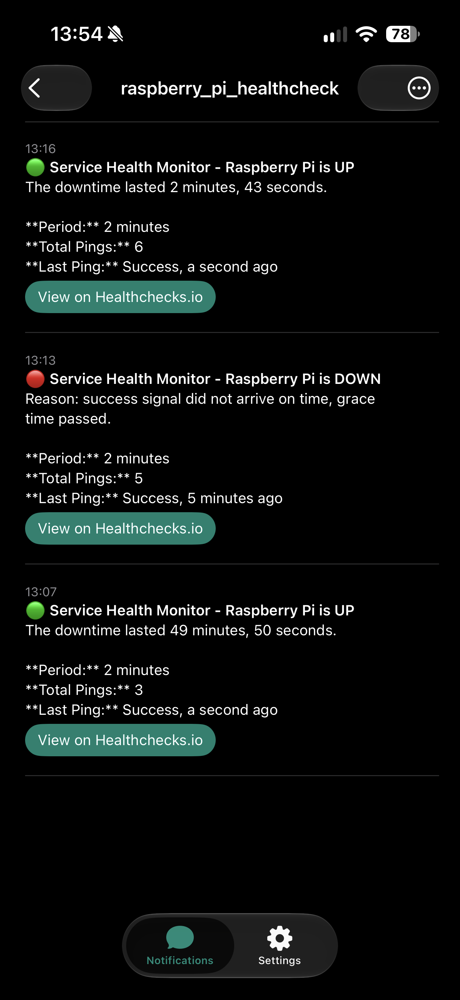
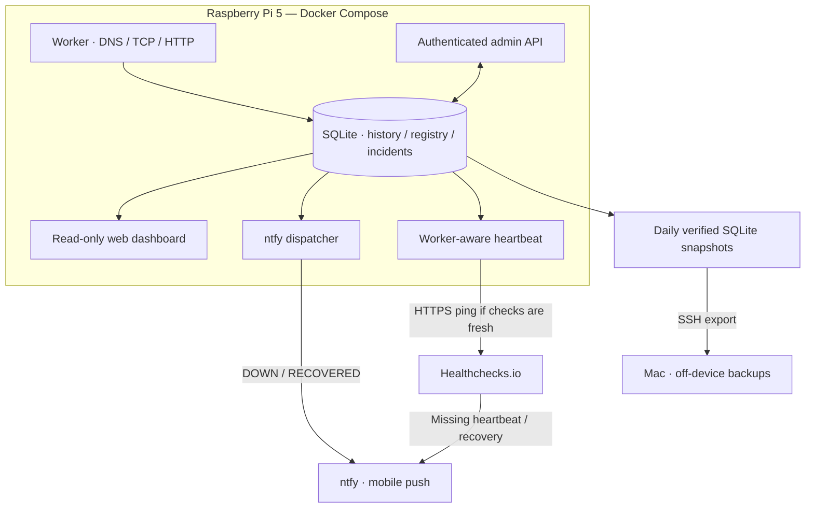

# Service Health Monitor

[](https://github.com/RatushAnton/service-health-monitor/actions/workflows/ci.yml)

**Self-hosted infrastructure monitoring with incident detection, mobile alerts, verified backups, and independent outage monitoring.**

Built from scratch in Python and deployed on a **Raspberry Pi 5** with Docker Compose. This is a hands-on DevOps portfolio project focused on solving an actual home-lab problem: knowing when network services go down **and** when the monitoring host itself stops working.

**Status: Operational and end-to-end validated (November 2026).** Five application containers are deployed. Controlled incident, notification, heartbeat outage, and heartbeat recovery tests all succeeded.

## At a glance

| Capability | Implementation |
| --- | --- |
| Service monitoring | DNS (A/AAAA), TCP, HTTP/HTTPS checks |
| Background operation | Worker every 5 minutes; thresholds for DOWN/RECOVERED |
| Dashboard and management | Read-only FastAPI dashboard and authenticated administration API |
| Persistence | SQLite monitor registry, check history, incident state and delivery queue |
| Mobile alerts | ntfy notifications dispatched every 60 seconds with retries |
| Host-outage detection | Healthchecks.io heartbeat every 60 seconds, gated by fresh worker checks |
| Data protection | Daily SQLite backups, integrity/restore checks and scheduled Mac off-device export |
| Quality | 152 passing local tests, Ruff checks, Python 3.11–3.13 GitHub Actions CI |
| Production footprint | Raspberry Pi 5; six enabled home-network monitors |

## Why I built it
A self-hosted network and infrastructure monitoring system built with Python, Docker Compose, FastAPI, SQLite and GitHub Actions.

Developed as a hands-on DevOps portfolio project and deployed on a Raspberry Pi 5.

Basic health checks are easy to run manually, but unreliable as an operational workflow. I wanted a system that would retain history, suppress transient failures, automatically send recovery alerts, survive restarts, and expose a usable dashboard. I also wanted to avoid the circular failure where a monitor goes offline and can no longer report its own outage.

The result is a working system—not just a CLI demonstration—with persistent incident processing, automated backups, and an **independent external dead-man's switch**. It works behind a dynamic public IP or CGNAT because all external communication is outbound HTTPS.

## Screenshots

The following screenshots were captured from the live Raspberry Pi 5 deployment.

### Monitoring Dashboard

Real-time visibility into the configured DNS, TCP and HTTP/HTTPS monitors, including service status and monitoring history.



### Monitor Administration

Authenticated administration interface for creating, editing, enabling and disabling monitors without restarting the monitoring worker.



### Incident Notifications

Mobile push notifications delivered through ntfy when monitored services transition to DOWN or RECOVERED.



### External Heartbeat Monitoring

Healthchecks.io independently monitors the Raspberry Pi through outbound heartbeats and alerts when the monitoring system becomes unreachable.



---


## Architecture



**Five long-running containers:** `worker`, `web`, `admin`, `notifier`, and `heartbeat`. A separate `registry-init` one-shot service imports the initial monitor configuration; subsequent changes are made through the admin API.

The web and admin services bind to the Pi's **localhost only** (`127.0.0.1:18080` and `127.0.0.1:18081`). Access from another machine uses an SSH tunnel rather than public port forwarding.

## Production validation

The system has been deployed to a Raspberry Pi 5 and validated against six enabled home-network monitors; three example monitors remain disabled.

| Scenario | Observed result |
| --- | --- |
| Worker, web dashboard and admin | Running; web and admin reported healthy |
| ntfy dispatcher | Running, processing persisted incident events |
| Synthetic incident detection | Three failed checks generated one `DOWN` event |
| Synthetic recovery | Next successful check generated one `RECOVERED` event |
| Incident delivery | Both events delivered to ntfy on the first attempt; both received on a phone |
| Worker-aware heartbeat | Verified recent checks for all six enabled monitors and submitted HTTPS pings |
| External heartbeat outage | Stopping **only** the heartbeat container triggered a Healthchecks.io mobile alert |
| External recovery | Restarting the heartbeat produced a recovery notification |
| Automated tests | 152 passed locally; one non-blocking dependency deprecation warning |

These were **controlled tests**. The service monitors actual infrastructure, but this project does not claim high availability or a completed full disaster-recovery cutover.

## Key engineering decisions

- **SQLite as a lightweight durable store:** Monitoring results, incident state, configuration and notification state are persisted across container restarts. Incident transitions and their check results are committed in a single transaction.
- **Threshold-based state machine:** Consecutive failures open incidents, while successful checks close them; this avoids sending alerts for every failed probe.
- **At-least-once notifications:** SQLite event claims, leases and exponential retry scheduling provide resilient delivery. Rare duplicate notifications are possible, and this is documented intentionally.
- **External failure domain:** Heartbeats originate from the Pi but are evaluated by Healthchecks.io. The heartbeat checks worker freshness rather than requiring all monitored targets to be UP, so genuine target outages do not suppress host monitoring.
- **Least-privilege deployment:** Non-root Docker users, read-only filesystems where appropriate, file-backed secrets, restricted capabilities and no publicly exposed web/admin ports.
- **Backup verification, not just backup creation:** SQLite online snapshots are checked for integrity and restored into temporary storage for validation; selected backups are then exported to a Mac over SSH.

## Tech stack

| Area | Tools |
| --- | --- |
| Application | Python 3.11+, FastAPI, HTTPX, dnspython, PyYAML |
| Data | SQLite |
| Runtime | Linux, Docker, Docker Compose, Raspberry Pi 5 |
| Notifications | ntfy, Healthchecks.io |
| Backup automation | SQLite online backup API, systemd timer, macOS launchd, SSH |
| Development | Git, GitHub pull requests, pytest, Ruff, GitHub Actions |

## Run it locally

Requires Python 3.11+ and Git. Local configuration is excluded from version control.

```bash
git clone https://github.com/RatushAnton/service-health-monitor.git
cd service-health-monitor
python3 -m venv .venv
source .venv/bin/activate
python -m pip install -e '.[dev]'
cp config/targets.example.yaml config/targets.yaml

healthmon check --config config/targets.yaml --db data/health.db
healthmon summary --db data/health.db
```

The example configuration includes a local demonstration service; that target will show DOWN unless you start the sample HTTP server. See the configuration and local test instructions in the repository's earlier development documentation/history.

## Operate the Raspberry Pi deployment

The base Docker Compose file runs the worker, dashboard and admin services. Two **opt-in** overlays provide ntfy dispatching and independent heartbeats:

- `compose.pi.yaml` — main application and SQLite volume
- `compose.pi.ntfy.yaml` — ntfy dispatcher
- `compose.pi.heartbeat.yaml` — external heartbeat

Read-only status check, from the Pi's deployment directory:

```bash
docker compose \
  -f compose.pi.yaml \
  -f compose.pi.ntfy.yaml \
  -f compose.pi.heartbeat.yaml \
  --profile notifications \
  --profile heartbeat ps
```

To view the UI privately from another machine, establish an SSH tunnel (replace `USER@PI_HOST`):

```bash
ssh -N \
  -L 28080:127.0.0.1:18080 \
  -L 28081:127.0.0.1:18081 \
  USER@PI_HOST
```

Then open `http://127.0.0.1:28080/` (dashboard) or `http://127.0.0.1:28081/admin/login` (admin). See the runbooks for first-time setup, private credentials, service activation and backups.

## Tests and continuous integration

```bash
python -m pytest -q
ruff check src/healthmon tests scripts/install-mac-backup-agent.py
ruff format --check src/healthmon tests scripts/install-mac-backup-agent.py
```

GitHub Actions checks Python **3.11, 3.12 and 3.13**, runs the test suite, verifies formatting and linting, and performs Docker image smoke tests. Production deployment is intentionally **manual and controlled**, rather than an automated push to the Pi.

## Documentation and code walkthrough

- [Architecture and key functions — interview code tour](docs/code-tour.md)
- [Raspberry Pi deployment](docs/pi-deployment.md)
- [SQLite backup and recovery](docs/backup-recovery.md)
- [ntfy notifications](docs/ntfy-notifications.md)
- [External heartbeat and outage validation](docs/external-heartbeat.md)

## Security and limitations

- Credentials, topic URLs, Ping URLs, configuration overrides and runtime databases must **not** be committed to Git.
- Public `ntfy.sh` topics without additional access controls rely on unpredictable topic names; notifications should not contain sensitive details.
- Delivery is **at-least-once**; a retry after a crash may produce duplicates.
- The external heartbeat detects complete host/connectivity outages and stale worker checks, **not** a stalled ntfy dispatcher.
- Docker memory limits are not enforced on the tested Pi kernel/cgroup configuration; this warning was observed during deployment.
- Backups and temporary restore checks are verified, but a **full production cutover from a backup** has not been performed.
- The system is a practical home-lab deployment, **not** a highly available or enterprise-managed monitoring platform.

## What this project demonstrates

A complete build-and-operate workflow: networking fundamentals; Linux and containers; Python services; durable state and event processing; incident alerting; security boundaries; CI and testing; automated backups; external dependency monitoring; and evidence-based production validation. The most interesting problems to discuss in an interview are **transactional incident events**, **at-least-once notification delivery**, and **monitoring the monitoring host itself**.
